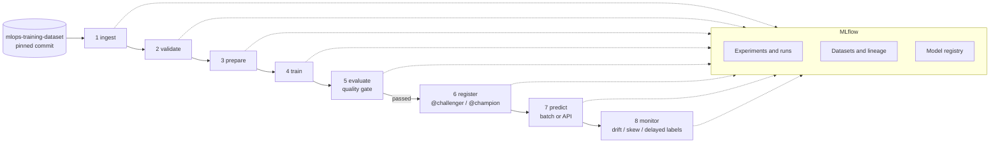

# MLOps course workspace

[](https://codespaces.new/majlisofai/mlops-course-template?quickstart=1)
[](https://github.com/majlisofai/mlops-course-template/actions/workflows/pipeline.yml)

An end-to-end MLOps pipeline, from source data to a served and monitored model, with **MLflow** tracking every stage.
Everything runs on GitHub, in your browser: you install nothing on your laptop.

| You need | Where it runs |
|---|---|
| VS Code | GitHub Codespaces, in the browser |
| MLflow tracking server, model registry, artifact store | A container in your Codespace (port 5000) |
| Model API | A container in your Codespace (port 5001) |
| CI: tests and the full pipeline on every push | GitHub Actions, using the same containers |

The data is synthetic and comes from [`majlisofai/mlops-training-dataset`](https://github.com/majlisofai/mlops-training-dataset), pinned to one commit:
**F1** (Grand Prix, predict `points_finish`) or **SPL** (Saudi league, predict `win`).

## Start in 3 steps

1. Click **Open in GitHub Codespaces** above (or **Code ▸ Codespaces ▸ Create codespace on main**). The first start takes about 3 minutes.
2. In the terminal, run:
   ```bash
   make pipeline
   ```
3. Open the **PORTS** tab and click the globe icon next to **MLflow UI (5000)**.

## The pipeline



`make pipeline` creates one MLflow **parent run** with a **nested run per stage**, in the experiment `<team>-<dataset>`.

| # | Stage | What it does | What MLflow records |
|---|---|---|---|
| 1 | `ingest` | Downloads the source files at the pinned commit | Source params, sha256 manifest, `mlflow.data` dataset input, raw files |
| 2 | `validate` | Checks schema, nulls, duplicates, ranges, categories and **leakage**. Any error stops the pipeline | Validation report, feature profile table, error and warning counts |
| 3 | `prepare` | Splits by season: train 2021-2024, holdout 2025 | Split params, row counts, train and holdout dataset inputs |
| 4 | `train` | Fits a scikit-learn pipeline with leave-one-season-out cross-validation | Hyperparameters, CV metrics, **logged model** with signature and input example |
| 5 | `evaluate` | Scores the holdout and compares with the baseline rule and by subgroup | Holdout metrics, confusion matrix, subgroup table, quality gate verdict |
| 6 | `register` | Registers the model if it passed the gate. Promotes it to `@champion` if it beats the current champion | Model version, tags, aliases `@challenger` / `@champion` |
| 7 | `predict` | Scores the 2026 season with `models:/<name>@champion` | Predictions CSV, inference dataset input |
| 8 | `monitor` | Checks input drift, training-serving skew and delayed labels (provisional vs final 2026 results) | PSI/KS tables, alerts as tags, 2026 accuracy on final labels |

## Commands

```text
make pipeline          every stage, one MLflow parent run
make <stage>           one stage: ingest validate prepare train evaluate register predict monitor
make serve             the @champion model as a REST API on port 5001
make predict-api       score 2026 through the API (run make serve in a second terminal first)
make test / make lint  what CI runs
make ui                print the MLflow UI address
DATASET=spl make ...   use the other dataset without editing team.yaml
```

Call the API yourself:

```bash
curl -s localhost:5001/invocations -H 'Content-Type: application/json' -d '{"dataframe_records": [
  {"grid": 1, "quali_gap_ms": 0, "driver_form": 2, "team_form": 25, "team_dnf_rate": 0.05, "rain_prob": 0.1, "circuit_type": "street"}]}'
```

## Your team's files

| Edit this | To change |
|---|---|
| `team.yaml` | Team name, dataset, model type and hyperparameters, quality gate, monitoring thresholds |
| `pipeline/*.py` | How a stage works (one file per stage) |
| `tests/` | What CI must check before anything merges |
| `configs/*.yaml` | The data contract, owned by the instructors: features, leakage columns, ranges, baseline rule |

The workflow for a change: create a branch, push it, open a pull request, check that CI is green and read the metrics in the job summary, then merge.

## Good to know

- **Push your work.** Your Codespace is temporary. When the course ends it is deleted, and anything not pushed to GitHub is lost.
- MLflow data lives in `.mlflow/` inside your Codespace. It survives stopping and restarting, but not deleting the Codespace. A CI run uploads its MLflow database and reports as an artifact.
- A Codespace stops after 30 minutes of inactivity. Reopen it from **Code ▸ Codespaces**.
- Exercises: [`docs/EXERCISES.md`](docs/EXERCISES.md). Instructors: [`docs/INSTRUCTOR.md`](docs/INSTRUCTOR.md).

All teams, drivers, players and results are synthetic: they are not a basis for betting or for claims about any real person or club.
